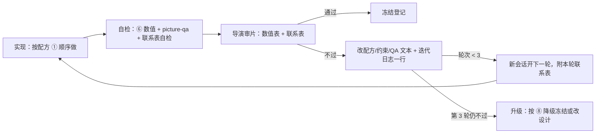

# 迭代协议 / Iteration protocol

难件（人物、材质、地表、光束、透镜这类决定画面底线的组件）和场景都不是一次做对的。本章规定一轮怎么走、最多走几轮、谁来判、怎么记，以及怎样在额度和共享服务器上不出事故。它来自一次多会话制作的对照：同一批难件，按“导演写详配方 + 每轮审片 + 一轮一会话”推进的一条线全部全规格冻结；由实现模型自己连跑三轮、只看自测数值的一条线全部降级冻结。差距主要来自工程，不是模型；第二个模型改走同一协议后，它的场景同样成立（经验 M35–M65，见[音乐视频经验](../tracks/music-video/lessons.md)）。组件阶段的循环见第 1–8 节，场景阶段、冻结件修复、确定性与提供方中断见第 9–12 节。

## 1. 每一轮的循环

1. **实现**：实现会话只照设计做，不做设计决定；设计没写到、写错或做不到时，在回填/LOG 写“哪一行、什么问题、建议”，按该件 ⑧ 继续。
2. **自检**：跑检查台全部视角 → 配方 ⑥ 数值 → `picture-qa`（构件按掩码：`--mask <区域> [--exclude <邻件>] --erode 2`，成对观感边界 `surface`，人物 `--silhouette`）→ 有相机运动时 `qa:camera`。声称修复必须附 `--compare <上一轮> --claim <检查项>`。除 ⑥ 外必报两类反向指标：可读性（目标景别下主体与背景亮度差）与禁止区（核心光源外 Y > .98、Y < .01 大块）。联系表生成后先算平均亮度与每格方差，全黑、全白或空格即生成失败。
3. **导演审片**：导演同时看数值表和联系表。“数值全过但画面明显不对”等于没过。导演只改配方、约束和 QA 文本，不写实现代码。
4. **配方修订**：把诊断写成可测的约束——成对上下限、分布形状、相对基线 + 区域判据、结构/形态指标、测量口径、适用条件；写成修订块（“rN 导演修订（第 N−1 轮：现象）”），并在迭代日志加一行。
5. **下一轮**：开**新会话**，任务里附上导演审过的本轮联系表；实现者先用几句话描述附件里的问题再动手。

### 修订怎么写：几个可照抄的形状

| 上一轮的现象 | 修订的形状 |
|---|---|
| 下限过了，画面卡通化、斑马纹、噪点 | 每个观感指标补上限：近景 p90/p10 ≤ 2.0；中间亮度区（p10–p90 的中间 50%）占比 ≥ 40%；3×3 高通 σ ≤ .02；纹理只走法线/粗糙度，反照率调制 ≤ ±6% |
| 伪影被压到阈值下，形状没变 | 判据改相对基线：“核心与主体掩码外，Y ≤ 同帧天空 p50 + .12；外缘 15% 环带 p99 ≤ .25”，HDR 前后各测；强制先逐层关闭二分定位来源，二分表写进 LOG |
| 人物与背景对比过了，却是纯黑剪影 / 帐篷 | 加掩码内表面指标（p90−p10、均值、细节、关键色相、暖光面积 ≤ 35%），再加结构指标（宽度剖面 肩 > 腰 < 摆，腰/摆 ≤ .75，至少一侧手臂分离 ≥ 躯干 15%） |
| 覆盖率过了，随机撒点、贴纸斑、星空、面片 | 规定分布（与腔体/凹凸相关 ≥ 80%）与形态（边缘过渡 ≥ 3 px @1080p、大小变异系数 ≥ .6、孤立亮点 ≤ 15/100×100 px、直边阶跃 ≤ 2%），宿主改平滑法线 |
| 检查台读成“灰盒子”、虚焦光条 | 宿主改真实形体；机位取分镜镜头；主体在焦、占画高 ≥ 50%；用该镜头的真实布光 |
| 整帧口径被设计内容和邻件污染 | 按本构件掩码测，排除区写 `_why`，交界处腐蚀 2 个分析瓦片，阈值不动 |
| 度量在设计光照下做不到 | 更正度量定义并写物理理由（例如改为足迹内 p95−p50 比），不放宽阈值 |
| 前景暗成平涂 | 光照要求写成区域亮度分位数（画面下 40% p50 ≥ .07、p10 ≥ .03），先加曝光、再加主光漫反射，各写上限 |

## 2. 三轮上限、降级冻结与冻结登记

- 每件（每个镜头问题）最多 **3 轮**。第 3 轮仍不过，转入迭代日志“升级”表，由导演决定：按配方 ⑧ **降级冻结**、改设计，或拆成新的组件。不开第 4 轮。
- **冻结**分三级：全规格冻结；降级冻结（启用 ⑧，写明丢掉了什么，例如“远景布面不动，运动源改由飞尘与薄雾承担”）；部分冻结 + open 项（主体冻结，个别指标另立 open 项并指定负责人与复测时机）。
- 冻结后接口与画面不再改。确需改时在冻结登记新开一行，写明理由，并重测依赖它的件。
- 模板：[ITERATION-LOG](../templates/ITERATION-LOG.md)（A 组件 / B 场景 / C 升级 / D 冻结登记 / E 交叉复核）。

## 3. 交叉复核：引擎缺陷与相互矛盾的结论

- 实现者报告“引擎缺陷”时**不改引擎**，先交另一会话独立复现。实测中这类报告约 2/3 是测量错误（例如采样点悬空 5 cm，在 3° 掠射下偏到 1.6 m 外）或报告者自己的 bug。复现证据链：源码 → 编译后着色器 → uniform 读回 → 像素差分。
- 两个会话结论冲突时，让它们对质并各自独立复现，导演按证据裁定，写进交叉复核表。
- 确认为真的底层问题以**可选开关、默认不变、旧画面逐字节一致**的方式落地（例如后期 develop 的几何重采样 `post.lens.resample: 'catrom'`，默认 `'bilinear'`），附改前/改后基准帧哈希表；是否启用由导演按镜头决定，启用后复测相关细节指标。
- “数值上存在”不等于“画面上可读”：例如影子一直在渲染，但掠射机位下只有 2 px 宽。可读性属于构图（机位、焦段），写进场景书，不压到构件上。

## 4. 改造优先

难件先找**已验收的底座**改造（ADAPT），保留底座的结构与验收；只有找不到已验收底座时才从零做（NEW-HARD），并写明理由。设计只引用当前源码已有的函数与工具参数，尚未实现的能力列为“计划增量”。检查台必须用本片该镜头时刻的真实灯光。

## 5. 附图与看不见图的会话

部分命令行会话在会话里读不到图，或时有时无，会在“盲做”中交出“数值过、画面不过”的结果。所以：

- 每轮派发都附导演审过的上一轮联系表（Claude Code 直接给路径并要求读图；codex 用 [dispatch.sh](../agents/codex/dispatch.sh) 的联系表参数以 `--image` 附上；其他命令行工具用各自的附件参数）。
- 实现者先复述附件里的问题再动手；读图不可用时明说，改用数值剖面 / ASCII 亮度图并写进 LOG。
- 联系表自检非空才算交付；方向也要校验：WebGL `readPixels` 的行序自下而上，直接拼会上下颠倒。联系表一律用截图工具输出的帧拼，拼完跑 `node tools/sheet-orient.mjs --sheet <表> --grid <列x行> --frames <原帧…>`（逐格与原帧比较四种方向，报翻转、错位、空白格）；没有原帧时用 `--grid` 不带 `--frames` 的“天在上”启发式，只适用于天比地亮的外景。
- 会话中途不调用内置读图工具：在部分命令行代理里它会让会话崩溃。需要看的图在派发时附上，开工读一次；中途只用数值剖面与 ASCII 亮度图。

## 6. 额度与并行

- 派发前按“每轮预计用量 × 并行会话数”对照额度窗口（例如 5 小时套餐上限）规划并行数，关键路径上的件优先。
- 每个会话每完成一步就更新自己的 LOG / `docs/CHECKPOINT.md`（已完成步骤、数值表、下一条命令）。被额度或超时切断时，新会话从断点续跑，不从头重做；迭代日志里该轮标“中断·续跑”。
- 并行权限仍需用户明确授权；额度规划不授予并行权限。
- 提供方中断（额度上限、过载 5xx、重连耗尽）的处理见第 12 节。

## 7. 收尾与卫生

- 会话结束前按 PID 关闭自己启动的所有服务与浏览器，汇报写“已关闭 PID …”。禁止 `pkill -f`、`killall`、按名字杀进程（见[共享服务器安全](10-shared-server-safety.md)）。
- 检查台/调试页的 URL 参数先 grep 引擎读取查询参数的位置，不与引擎已有参数同名（例如自定义 `ph` 与引擎画幅高撞名），建议加件名前缀。
- 实现会话不动 git；由导演每轮统一提交，**只按明确路径提交**已交付会话的文件（会话汇报列出自己改过的文件）。并行会话共享工作树时，目录级提交或 `commit -a` 会收进另一会话改到一半的文件，破坏它的对照基准。

## 8. 迭代日志格式

每轮一行，核心是“约束改动 → 可见结果”：

| 件 | 轮 | 失败模式（⑦ 编号） | 配方/约束改动（文件 §：原句 → 新句） | 可见结果（联系表路径；指标 前 → 后） | 结论与一句教训 |
|---|---|---|---|---|---|
| 地表 | 2 | 新增：高反差斑马纹、像素噪点 | 配方 ⑥：“细节 ≥ …” → “近景 p90/p10 ≤ 2.0、中间亮度区占比 ≥ 40%、3×3 高通 σ ≤ .02”；纹理只走法线 | 平涂 25–28% → .3–.9%，但出现斑马纹 | 进入第 3 轮。只设下限的指标会被过度满足 |
| 检查工具 | 2 | 运动源虚警 | 测量改为 1920 宽 + 锁颗粒，阈值不动 | 虚警 36 → 5，像素逐字节不变 | 通过·冻结。修正测量条件比放宽阈值可靠 |

日志里的教训在项目结束时整理回通用经验（tracks/*/lessons.md），只写方法与因果，不写作品内容。根因栏分“报告者结论 / 独立查证结论”两列，没有独立查证的根因不写回经验。

## 9. 场景阶段

场景按“空场与光 → 英雄画面 → 其余预设 → 收口”四个阶段推进，每阶段一轮或多轮，仍是一轮一会话、轮间导演审片。

0. **工程准备**：复制技术栈后逐项核对继承常数——时长、总帧数、帧率、淡入淡出时刻、署名、歌词、预热计划；加测试“末帧时刻 = 歌曲时长、淡出在最后一句之后”。
1. **英雄先行**：先做英雄镜头，通过后才做其余预设。英雄画面里可见的每个件（不论难易）都必须是检查台冻结件；发现英雄画面里有场景会话顺手做的件时，暂停该镜头迭代，先开构件会话补检查台与验收，冻结后再用冻结件重新装配。检查台同时交分镜机位与整件全形视角（3/4 俯视与侧视，主体占画高 ≥ 60%）。
2. **英雄每轮回归**：英雄通过后定基准帧；之后每一轮（含其余预设、冻结件修复、引擎改动）都重出英雄基准帧并逐字节对比，差异必须能解释到具体改动（例如只在玻璃/反射区），由导演决定是否重定基准。
3. **夜景读法**：每个镜头写明是**剪影**（主体压在更亮的背景前，主体与背景亮度差 ≥ .08，背景 p50 区间）还是**受光主体**（主光方向、受光面区域分位数）。背对主光的面保持暗（环境/半球补光对背光面 ≤ 20%，背光面 p50 ≤ .04）；实际光源只点出局部；低角度主光下受光面的纹理是物理正确的，不压。低空月光会被大气消光染暖，设计要冷月时用写明理由的预校色，在受光面掩码内验 G/R、R/B。
4. **拒绝捷径**：审片固定检查——有没有假贴片/假影子/假光；机位是否超出分镜的高度与焦段范围；应运动的东西（旋转光束、风动件）是否停了；时间轴、镜头时长是否被改动；设计里的件是否被删掉或移出画面。任一为“是”就判不过，即使数值全过；追查捷径背后的真实障碍（多半是冻结件在新条件下的缺陷），按第 10 节修复，或由导演改调度。
5. **冻结件在本场景光照下复验**：场景装配时在本场景的灯光与机位下重跑每个冻结件自己的判据（例如灰缝/石块亮度比、星空检测、光束外泄）。不过的记为冻结件缺陷，按第 10 节修，不在场景层压。
6. **区分度检查**：每个场景交一张“上一场景英雄帧 对 本场景英雄帧”的并排图，写明光、色、空间三方面差异；同一件在两个场景的前景都出现时写理由。共享件不能当“万能前景”。
7. **收口**：确定性（第 11 节）、叠化端点、性能、`npm run qa:camera`（含万向节检查：同一镜头相邻帧在 |俯仰| > 80° 时偏航或横滚变化 > 3° 即 FAIL——相机路径不经过天顶/天底）、SET 回填“最终”、最终联系表（方向已校验）。已知项写入集成阶段清单。

## 10. 冻结件修复

冻结件的缺陷（经第 3 节独立复现确认）由单独的修复会话处理，场景会话只写请求、不改冻结件。

1. **新行为默认不变**：修复以可选参数、或对现有调用画面不变的方式落地（例如新增 `mortarTint`，默认等于旧行为）；确需改变默认时写明理由并列出全部受影响场景。
2. **双重验收**：检查台全部视角逐字节一致（或差异只在被修的缺陷区域）+ **使用该件的每个场景的基准帧回归**：缺陷区域按修复目标改善，关键内容（例如远处光束）的亮度变化 ≥ 修前 80%，其余区域逐字节一致或写明差异来源。只做检查台字节一致会漏掉场景回归——一次光束近距淡出的修复在检查台视角不变，却把另一场景 94–142 m 外的光束一起淡没。
3. **登记**：冻结登记表新开一行（修复编号、改动、默认是否变化、回归帧哈希表），场景会话删除自己为绕开该缺陷写的兜底代码并复测。

## 11. 确定性协议

同进程连续重复渲染一致**不能**证明画面与渲染历史无关。确定性测试必须同时覆盖：

- **跨进程**：两个独立浏览器进程（可绑不同 CPU）渲染同一组帧，逐字节比较；
- **乱序**：帧序随机打乱，并在其间插入其他场景/时刻的干扰帧；
- **同帧复渲**：同一进程内对同一帧再渲一次。

常见历史依赖：场景 `update()` 读到上一样本遗留的 world 矩阵（修法：每个样本先做一遍预备 pass，所有姿态由本样本生成）；three.js PMREM 等环境图缓存冻结在进程首帧的天空（修法：天空重渲后置 `needsPMREMUpdate` 或等价失效）；惰性构建与缓存按“首次使用”初始化。修复后旧场景逐字节一致，差异只允许出现在被修的区域，由导演授权重定基准。收口阶段至少 8 个时刻、覆盖场景全部镜头。

## 12. 提供方中断与额度

- **规划**：派发前按“每轮预计用量 × 并行会话数”对照额度窗口（例如 5 小时上限）规划并行；关键路径优先。一个提供方过载时，不把全部会话同时转到另一提供方的同一额度窗口。
- **续跑循环**：每个实现会话用 [`agents/run-with-resume.sh`](../agents/README.md) 启动：日志末尾出现过载 / 5xx / 额度 / 重连耗尽等标记时，按 PID 清理该会话端口上的遗留服务 → 等待（默认 10 分钟）→ 可选探测提供方 → 在提示前加“断点续跑”说明重启，最多 N 次。真实的任务失败（没有提供方标记的非零退出）不重试。
- **断点**：会话每完成一步更新 LOG / CHECKPOINT（已完成步骤、数值表、下一条命令）；续跑提示要求先复述最后完成的一步，不重做、不回退文件。迭代日志该轮标“中断·续跑”，注明尝试次数。
- **清理**：每次重试前按 PID 关闭本会话端口上的服务与浏览器；不按名字杀进程，不碰别的端口。

English: one round per session; each round = implement → self-check (numbers, picture-qa, non-blank contact sheet) → director review of numbers and contact sheet → recipe revision logged as "constraint change → visible result" → new session with the reviewed contact sheet attached. Three rounds per part, then a degraded freeze recorded in a freeze registry. Engine-defect claims are reproduced by an independent session first; real fixes ship as opt-in switches with byte-identical defaults. Plan parallel sessions against quota windows and resume from checkpoints. Kill your own PIDs before exiting; never name lab URL parameters after engine parameters. Scene phase: hero first, every hero-visible part frozen through a lab (storyboard view plus whole-form view), hero baseline regressed every round, shortcuts (fake decals, extreme cameras, parked motion, retimed shots) rejected, night reading mode (silhouette or lit) stated per shot, side-by-side distinctness check between scenes, frozen parts re-verified under each scene's lighting. Frozen-part fixes are opt-in or default-unchanged and need lab byte-identity plus scene-frame regression. Determinism is tested cross-process and out of order. Provider outages: plan concurrency to quota and wrap sessions in agents/run-with-resume.sh. Directors commit by explicit path only.
